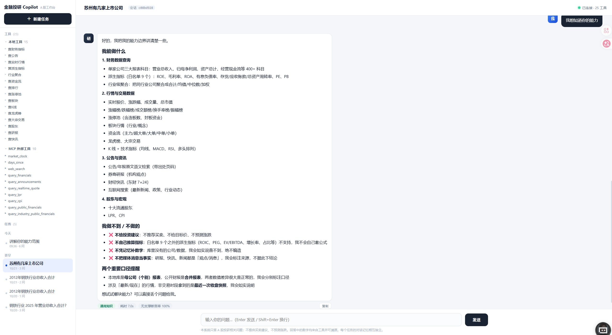
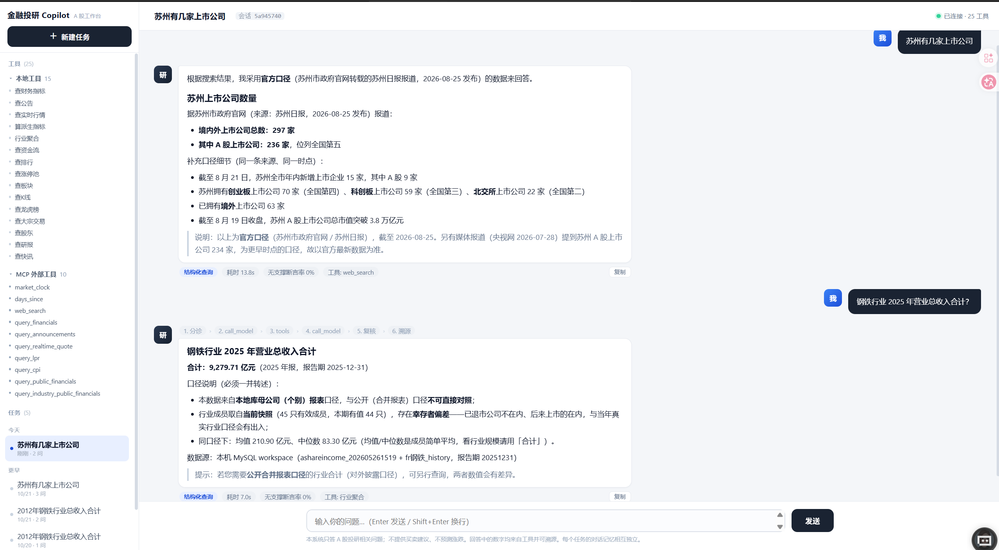
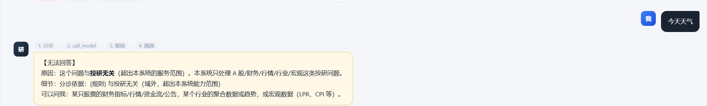
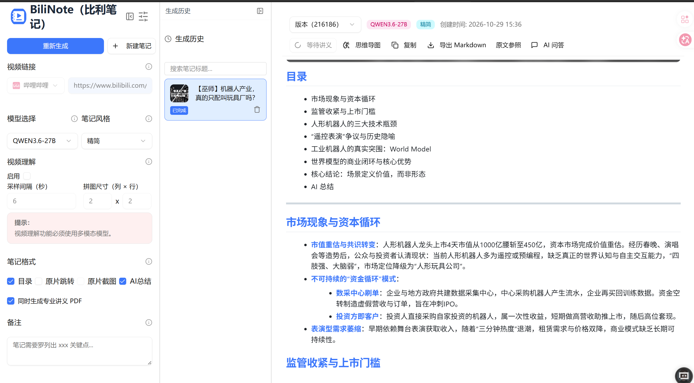
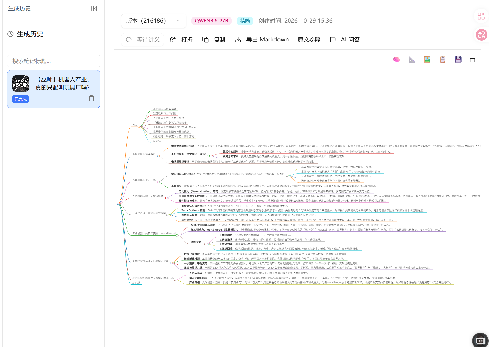

# 金融投研 Copilot

> 基于 LangGraph 的 A 股投研问答 Agent：查本机财务库、读年报公告原文、取实时行情与外部数据，并且**每个数字都给得出出处**。

## 这是什么

一个端到端的投研问答助手。用户用自然语言提问（如"宝钢股份 2025 年营业总收入是多少？"），系统自动判断**该不该答、走哪条通道、调哪个工具**，最后给出带出处的回答。

它把**可信度**当作第一约束：

- 数字必须来自工具，不允许模型自己算、自己编；
- 答案里每个数值都会被逐条核对有没有出处，核不过的整条拦下；
- 越界问题（买卖建议 / 涨跌预测）直接拒答。

## 界面预览

系统自述能力边界，并给出可直接追问的示例：



行业级聚合（跨公司口径），回答中标注数据来源与口径：



与投研无关的问题会被直接拒答，并说明分诊依据：



## 核心能力

| 能力 | 说明 |
|---|---|
| 结构化财务查询 | 本机 MySQL，全市场约 6700 家公司 × 42 个指标，支持季度 |
| 指标字典 + 语义检索 | 科目中文名与口语说法均可命中（"毛利润"→毛利率），三路召回 |
| 公告 / 年报原文 | RAG 检索 PDF 原文，返回文件名与页码 |
| 实时行情 | 腾讯 / 东财 / 新浪三源兜底（股价、指数、涨跌） |
| 行业聚合 | 跨公司聚合行业指标：合计 / 均值 / 中位数 / 加权口径，覆盖 28 个申万一级行业 |
| 派生指标 | ROE / 毛利率 / PE / PB 按白名单真公式计算（工具算，不是模型算） |
| 外部数据（MCP） | 网页搜索、宏观 LPR·CPI、公开财报，经 MCP 进程接入 |
| 多轮与偏好 | 对话记忆 + 跨会话偏好 + 人工介入 |
| 服务化 | FastAPI + SSE 流式，附带单文件网页前端 |
| 评测回归 | 金标准集三层执行（确定性 / 外部 / 端到端），可挂 CI |

## 架构

五层，自顶向下：

1. **接入层** —— `index.html`，单文件网页前端
2. **服务层** —— `server.py`，FastAPI + SSE，负责会话与流式输出
3. **编排层** —— `graph.py` / `state.py`，LangGraph 状态图：分诊 → 调用 → 复核 → 溯源
4. **护栏层** —— `guard.py` / `关系判据.py`，分诊规则、断言溯源、越界检测
5. **工具层 + 数据层** —— 工具（`tools.py` / `market_tool.py` / `realtime_tool.py` / `派生指标.py` / `行业聚合.py` / `rag_tool.py` 等）对接数据（MySQL / 向量库 / 外部数据源 / MCP）

## 四通道分诊

回答之前，先决定"答不答、怎么答"：

- **A 结构化查询** —— 有明确标的 + 指标 → 查库
- **B 受约束泛问** —— 需要工具但不确定查什么 → 强制调工具
- **C 拒答** —— 越界（买卖建议 / 预测）或域外（与投研无关）→ 直接拒答
- **D 概念解释 / 行业主题 / 系统自述** —— 用通用知识作答并标注，不查库

## 四层护栏

1. **提示层（软）** —— 系统提示写明红线：不许自算比率、不许编造页码
2. **能力层（硬）** —— SQL 下沉到工具，模型拿不到底层连接
3. **校验层** —— 复核节点检查答案是否越界
4. **溯源层** —— 逐条断言核对：答案里每个数字都要能在工具原文里找到出处（含量纲归一化与概数容差）

## 快速开始

```bash
# 0) 配置依赖
cp .env.example .env          # 填 LLM_BASE_URL / LLM_API_KEY / LLM_MODEL，以及 DB_*
pip install -r requirements.txt

# 1) （可选）构建指标字典表：需要本机 MySQL 且已有 workspace 库
python 指标字典_建表.py

# 2) （可选）构建公告向量库：语料 PDF 就位后执行
python rag_ingest.py

# 3) 单轮问答
python run.py "宝钢股份 2025 年的营业总收入是多少？"

# 4) 多轮交互（支持 /偏好、/新会话、/会话 命令）
python run_multi.py

# 5) 起 HTTP 服务 + 网页前端
python server.py               # 浏览器打开 http://127.0.0.1:8000
#    Windows 也可直接双击 启动服务.cmd

# 6) 回归自测（改完代码先跑这个）
python 一键回归.py              # 默认 L1+L2；--只L1 最快；--含LLM 追加端到端
```

> 所有密钥与密码都走环境变量 / `.env`，仓库内不含任何真实凭据。

## 目录说明

```
├── index.html                       网页前端（单文件）
├── server.py                        HTTP 服务（FastAPI + SSE）
├── graph.py / state.py              LangGraph 编排与状态
├── guard.py / 关系判据.py             护栏、分诊与关系判据
├── tools.py                         财务查询（MySQL）
├── market_tool.py                   行情 / 资金流 / 龙虎榜等接口工具
├── realtime_tool.py                 实时行情
├── 派生指标.py / 行业聚合.py           派生指标与行业聚合
├── 指标字典.py / 指标字典_建表.py        指标字典查询与建表
├── rag_tool.py / hybrid_search.py   RAG 检索入口与混合检索
├── rag_search.py / rag_ingest.py
├── vector_store.py / bm25.py / schema_index.py
├── mcp_bridge.py / mcp_server*.py   MCP 同步桥与服务端
├── search_mcp_server.py / macro_mcp_server.py / mcp_client.py
├── run.py / run_multi.py / cli.py   命令行入口
├── 一键回归.py / 金标准集.py           评测回归
├── stock_names.json / stock_aliases.json / 字段映射.json   数据映射
├── screenshots/                     界面截图
├── samples/                         样例文档
├── .env.example / requirements.txt / 启动服务.cmd
```

## 附：样例文档

本仓库收录一份「视频 → 结构化研究笔记」的样例（由开源工具 BiliNote 生成），点击链接即可查看完整 Markdown：

- 📄 [【巫师】机器人产业，真的只配叫玩具厂吗？](samples/robotics-industry-note.md)

生成过程（BiliNote 界面：要点笔记 / 思维导图）：





## 已知边界

- 公告语料示例为宝钢 600019.SH 若干份 PDF，可按需增量入库
- 实时行情支持 5 个指数 + 任意 wind_code
- 数据口径：同一公司同一期可能存在"母公司 / 合并"两套口径，回答中会分别标注，二者不代表其中一个"错"
